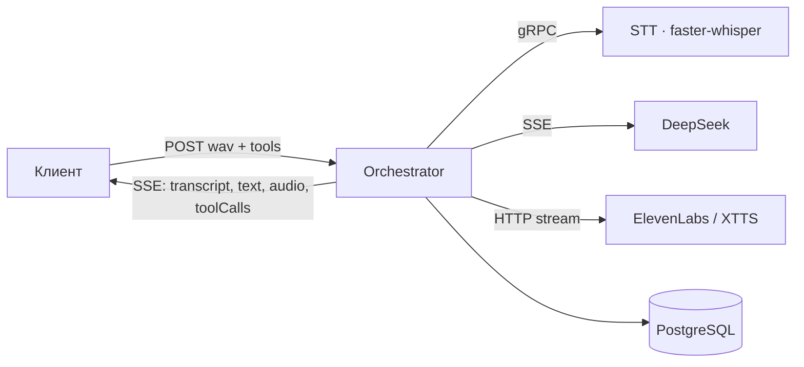

# YukiVA

Голосовой AI-ассистент на .NET 10. Ответ приходит потоком: распознанная фраза
видна сразу, текст печатается по мере генерации, а голос начинает звучать
после первого предложения, не дожидаясь конца ответа. Модель может вызывать
инструменты (MCP), их исполняет клиент.




## Запуск

Нужны .NET SDK 10, Docker и, для STT, видеокарта NVIDIA.

```bash
# 1. База (миграции применятся сами при старте API)
docker compose up -d

# 2. Распознавание речи
cd src/Services/YukiVA.Service.STT
bash download_models.sh large-v3-turbo
docker compose up -d stt-large-v3-turbo
cd -

# 3. Ключи
dotnet user-secrets set "Llm:ApiKey" "<DeepSeek>" --project src/Orchestrator/YukiVA.Orchestrator.Api
dotnet user-secrets set "Tts:ElevenLabs:ApiKey" "<ElevenLabs>" --project src/Orchestrator/YukiVA.Orchestrator.Api

# 4. Оркестратор → http://localhost:5000
dotnet run --project src/Orchestrator/YukiVA.Orchestrator.Api
```

Проверить без клиента:

```bash
curl -N -F audio=@speech.wav -F tools=[] http://localhost:5000/api/voice
```

Локальный TTS вместо облака: `Tts:Provider = Xtts` (сервис в `src/Services/YukiVA.Service.TTS`).

## Тесты

```bash
dotnet test src/Orchestrator/YukiVA.Orchestrator.slnx --filter "Category!=Manual"
```

Тестам репозитория нужен запущенный Docker (Testcontainers). Тесты
`Category=Manual` обращаются к настоящим DeepSeek и ElevenLabs и измеряют
задержки.

## API

| Метод | Путь | Ответ |
|---|---|---|
| `POST` | `/api/voice?sessionId={guid?}` — multipart: `audio`, `tools` | `text/event-stream` |
| `POST` | `/api/voice/tool-results` — `{ sessionId, results: [{ toolCallId, content }], toolsJson }` | `text/event-stream` |
| `GET` | `/api/sessions/{id}/messages` | JSON |

События потока: `session`, `audioFormat`, `transcript`, `text`, `audio`
(PCM 16 бит, моно, 24 кГц в base64), `toolCalls`, `error`, `done`.

## Лицензия

[MIT](LICENSE)
